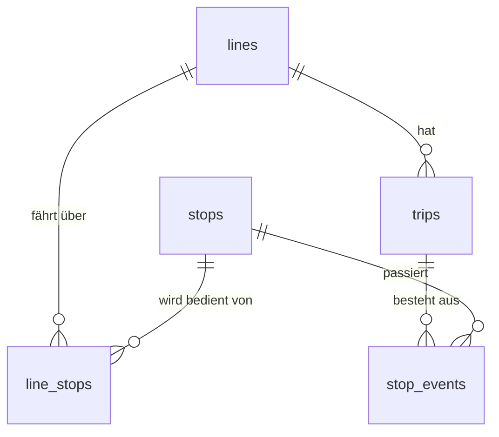

# Übung 1: Daten verknüpfen (90 Minuten)

**Datenbank:** `kvv` (5 Tabellen). **Aufgaben:** 1.1 bis 1.23 in `exercises/uebung-1.toml`, davon 19 Pflicht und 4 Zusatzaufgaben (1.8, 1.12, 1.16, 1.23).

## Ziel

Studierende verstehen, warum Daten auf mehrere Tabellen verteilt werden, erkennen Primär- und Fremdschlüssel und können Tabellen mit Subquery, `JOIN` und `LEFT JOIN` wieder zusammenführen und auswerten.

## Voraussetzungen (Übung 0)

- Sicher: `SELECT`, `WHERE`, `LIKE`, `ORDER BY`, `LIMIT`, Aggregate, `GROUP BY`, `HAVING` auf der flachen Tabelle `delays`.
- Neu in dieser Übung: mehrere Tabellen, Schlüssel, Subquery, `JOIN`, Aliase, `LEFT JOIN`, `NULL`.

## Das Modell



- `lines` (7) und `stops` (21) sind Stammdaten. `line_stops` (37) verbindet sie (n:m, mit `position`).
- `trips` (250) sind einzelne Fahrten, `stop_events` (1328) die Halte einer Fahrt. Das ist der Inhalt von `delays` aus Übung 0, nur ohne Wiederholungen.

## Minutenplan

| Min | Was | Aufgaben |
|---|---|---|
| 0-5 | `data/kvv.db` in VS Code mit „SQLite Viewer“ öffnen, alle 5 Tabellen durchklicken, `id`-Spalten und Verweise (`line_id`, `stop_id`, `trip_id`) zeigen lassen; Vergleich mit `flat.db`: gleiche Daten, aufgeteilt | |
| 5-10 | Motivation „Warum Tabellen aufteilen“ (siehe unten) | |
| 10-13 | Demo 1: Tabellen und Schlüssel | |
| 13-21 | Aufgabenzeit | 1.1 bis 1.4 |
| 21-26 | Demo 2: Subquery | |
| 26-34 | Aufgabenzeit | 1.5 bis 1.7 (1.8 Zusatz) |
| 34-39 | Demo 3: JOIN | |
| 39-51 | Aufgabenzeit | 1.9 bis 1.11 (1.12 Zusatz) |
| 51-56 | Demo 4: Joins und Aggregation | |
| 56-66 | Aufgabenzeit | 1.13 bis 1.15 (1.16 Zusatz) |
| 66-70 | Demo 5: `LEFT JOIN` und `NULL` | |
| 70-77 | Aufgabenzeit | 1.17 bis 1.19 |
| 77-87 | Abschluss „Fragen an das Netz“ (ohne Demo, 2 Minuten Einführung) | 1.20 bis 1.22 (1.23 Zusatz) |
| 87-90 | Rückblick: Lösungen besprechen (1.19 und 1.21 sind die Stolperfallen), Ausblick | |

Zeitpuffer: Wer hinterherhinkt, überspringt Zusatzaufgaben und macht Abschnitt 6 als Hausaufgabe. Schnelle Studierende nehmen die Zusatzaufgaben.

## Motivation: Warum Tabellen aufteilen? (5 Minuten)

Zahlen aus `flat.db`:

```sql
SELECT COUNT(*), COUNT(DISTINCT stop), COUNT(DISTINCT line) FROM delays;
```

- 1328 Zeilen, aber nur 20 verschiedene Haltestellen und 7 Linien: Die Namen stehen im Schnitt über 60 Mal in der Tabelle (zusammen rund 17 000 Zeichen allein für Haltestellennamen).
- Ändert sich ein Name (Tippfehler, Umbenennung), müsste man ca. 65 Zeilen anpassen statt einer.
- `flat.db` kennt `Messe Süd` gar nicht: Eine Haltestelle ohne Halt kann in der flachen Tabelle nicht existieren. In `kvv` steht sie in `stops`.
- Eine Zelle, ein Wert: Eine Linie hat mehrere Haltestellen, eine Haltestelle mehrere Linien. Dafür braucht es die Zwischentabelle `line_stops` (n:m).
- Preis: Für Auswertungen müssen die Tabellen wieder verbunden werden. Das ist das Thema dieser Stunde.

## Live-Demo je Abschnitt (zum Mittippen)

Die Demos nutzen die Linie `S1`, die Aufgaben die Linie `3`.

**Demo 1: Tabellen und Schlüssel**

```sql
SELECT * FROM stops LIMIT 5;
SELECT * FROM line_stops LIMIT 5;
SELECT * FROM stop_events LIMIT 5;
```

Fragen an die Gruppe: Welche Spalte benennt die Zeile eindeutig (Primärschlüssel `id`)? Welche Spalten verweisen auf andere Tabellen (Fremdschlüssel `line_id`, `stop_id`, `trip_id`)? Warum hat `line_stops` keine eigene `id`? (Primärschlüssel ist das Paar `line_id` und `stop_id`.)

**Demo 2: Subquery**

```sql
SELECT id FROM lines WHERE name = 'S1';   -- 1

SELECT stop_id FROM line_stops WHERE line_id = 1;

SELECT name, zone FROM stops
WHERE id IN (SELECT stop_id FROM line_stops
             WHERE line_id = (SELECT id FROM lines WHERE name = 'S1'));
```

Von innen nach außen lesen. `=` für genau einen Wert, `IN` für mehrere.

**Demo 3: JOIN**

```sql
SELECT stops.name, line_stops.position
FROM lines
JOIN line_stops ON line_stops.line_id = lines.id
JOIN stops ON stops.id = line_stops.stop_id
WHERE lines.name = 'S1'
ORDER BY line_stops.position;

-- gleiche Abfrage mit Aliasen
SELECT s.name, ls.position
FROM lines AS l
JOIN line_stops AS ls ON ls.line_id = l.id
JOIN stops AS s ON s.id = ls.stop_id
WHERE l.name = 'S1'
ORDER BY ls.position;
```

Ergebnis: Ettlingen Stadt, Hauptbahnhof, Durlacher Tor, Hagsfeld Bahnhof, Pfinztal Berghausen. Kurz zeigen: `ON` weglassen erzeugt alle Kombinationen (`lines` x `line_stops` = 7 x 37 = 259 Zeilen).

**Demo 4: Joins und Aggregation**

```sql
SELECT lines.name, COUNT(*) AS trips_count
FROM lines
JOIN trips ON trips.line_id = lines.id
GROUP BY lines.id
ORDER BY trips_count DESC, lines.name;
```

Ergebnis: `2` (40), `1` (38), `S2` (38), `12` (35), `73` (35), `3` (32), `S1` (32). Join zuerst, dann gruppieren, danach filtert `HAVING` die Gruppen.

**Demo 5: LEFT JOIN und NULL**

```sql
SELECT COUNT(*) FROM stops JOIN line_stops ON line_stops.stop_id = stops.id;       -- 37
SELECT COUNT(*) FROM stops LEFT JOIN line_stops ON line_stops.stop_id = stops.id;  -- 38

SELECT stops.name, COUNT(line_stops.line_id) AS lines_count
FROM stops
LEFT JOIN line_stops ON line_stops.stop_id = stops.id
GROUP BY stops.id
ORDER BY lines_count, stops.name
LIMIT 3;   -- Messe Süd (0), Grötzingen (1), Kaiserplatz (1)
```

Die eine Zeile mehr ist `Messe Süd` mit `NULL` in allen Spalten von `line_stops`. Auch zeigen: `COUNT(*)` würde hier 1 statt 0 liefern.

## Stolpersteine

- `name` und `id` gibt es in mehreren Tabellen: immer qualifizieren (`stops.name`) oder Aliase nutzen. Fehlermeldung „ambiguous column name“ erklären.
- `JOIN` ohne `ON` oder mit falscher Bedingung: Zeilenzahl explodiert. Faustregel: Zwei Tabellen, eine `ON`-Bedingung.
- `=` mit Subquery, die mehrere Zeilen liefert (1.7): `IN` verwenden.
- Alias erst nach `FROM` definiert, aber in `SELECT` nutzbar. Ein Alias, der vergeben wurde, muss überall verwendet werden (nicht mehr `lines.name`).
- Spaltenanzahl und -namen laut Aufgabe: Die Prüfung vergleicht Zeilen und Spaltenanzahl, nicht die Namen. Reihenfolge der Spalten wie in der Aufgabe.
- `GROUP BY` über mehrere Joins: nach `id` gruppieren, nicht nur nach `name`, wenn Namen nicht eindeutig wären.
- `HAVING` filtert Gruppen, `WHERE` Zeilen vor dem Gruppieren (1.13, 1.16).
- 1.18: `COUNT(*)` statt `COUNT(stop_events.id)` zählt bei `LEFT JOIN` die `NULL`-Zeile mit, `Messe Süd` hätte 1 statt 0.
- 1.19: `WHERE trips.weather = 'snow'` macht den `LEFT JOIN` wieder zum `INNER JOIN` (`Messe Süd` und alle Halte bei anderem Wetter fallen weg). Die Bedingung gehört ins `ON`. Typische falsche Lösung zeigen: Ergebnis enthält nur `Kaiserplatz`, `Messe Süd` fehlt.
- 1.21: Linie `73` fehlt, weil sie keine Halte in Zone 1 hat. Kein Fehler, sondern Absicht.
- 1.22: Hauptverkehrszeit nach planmäßiger Zeit des Halts, nicht der Abfahrt der Fahrt. Bei Fehlern `strftime('%H', ...)` einzeln ausprobieren.

## Erwartungswerte der Schlüsselaufgaben

| Aufgabe | Erwartetes Ergebnis |
|---|---|
| 1.2 | Zone 1: 6, Zone 2: 2, Zone 3: 3, Zone 4: 2 |
| 1.3 | `line_id` 1 bis 7: 5, 5, 6, 6, 5, 5, 5 |
| 1.4 | 1328 Halte, Durchschnitt 3.25, Maximum 12, 86409 Einsteiger |
| 1.5 | `stop_id` 9, 1, 4, 2, 8 (Positionen 1 bis 5) |
| 1.6 | 8 Haltestellen in Zone 1, beginnend mit `Durlacher Tor`, endend mit `Mühlburger Tor` |
| 1.7 | Entenfang, Hauptbahnhof, Kaiserplatz, Kronenplatz, Marktplatz |
| 1.8 (Zusatz) | 568 |
| 1.9 | 23 Fahrten bei Schnee (erste: 90 `S1` `outbound`) |
| 1.10 | Entenfang, Hauptbahnhof, Kronenplatz, Marktplatz, Kaiserplatz |
| 1.11 | Ettlingen Stadt (73), Ettlingen Stadt (S1), Grötzingen (S2), Neureut Kirchfeld (12), Pfinztal Berghausen (S1) |
| 1.12 (Zusatz) | 4 Zeilen: Grötzingen S2 12 min, dann je 10 min: Ettlingen Stadt (Linie S1), Neureut Kirchfeld (Linie 12), Durlacher Tor (Linie 1) |
| 1.13 | 16 Haltestellen; `Hauptbahnhof` mit 3 Linien (S1, S2, 3), alle anderen mit 2 |
| 1.14 | S1 4.33, S2 3.71, 73 3.57, 12 3.31, 1 2.84, 3 2.73, 2 2.60 |
| 1.15 | Zone 1: 570 Halte, 3.21; Zone 2: 290, 3.03; Zone 3: 296, 3.03; Zone 4: 172, 4.09 |
| 1.16 (Zusatz) | sbahn 350 Halte 3.99; bus 350 Halte 3.44 (tram mit 2.72 fällt raus) |
| 1.17 | `Messe Süd`, Zone 3 |
| 1.18 | Messe Süd 0, Kaiserplatz 32, Pfinztal Berghausen 32, Neureut Kirchfeld 35, Grötzingen 38 |
| 1.19 | Messe Süd 0, Kaiserplatz 2 |
| 1.20 | 12 Zeilen; Schnee ist am schlimmsten: bus 6.47, sbahn 6.54, tram 4.95; niedrigster Wert: tram bei Wolken (2.03) |
| 1.21 | S2 125.4, S1 122.5, 2 75.4, 3 72.3, 1 69.9, 12 39.0 |
| 1.22 | S1 5.25 (95 Halte), S2 4.43, 73 4.15, 12 3.99, 1 3.33, 3 3.27, 2 2.99 |
| 1.23 (Zusatz) | S1 Pfinztal Berghausen 4.81, S1 Ettlingen Stadt 4.72, S1 Durlacher Tor 4.59 (je 32 Halte) |

Auswertungsgedanke für die Schlussrunde: Schnee und Hauptverkehrszeit erhöhen die Verspätung, die S-Bahn ist am schlechtesten (die drei schlechtesten Kombinationen aus Linie und Haltestelle sind alle S1), Zone 4 hat die höchste Verspätung, `Messe Süd` ist Planung ohne Betrieb.
