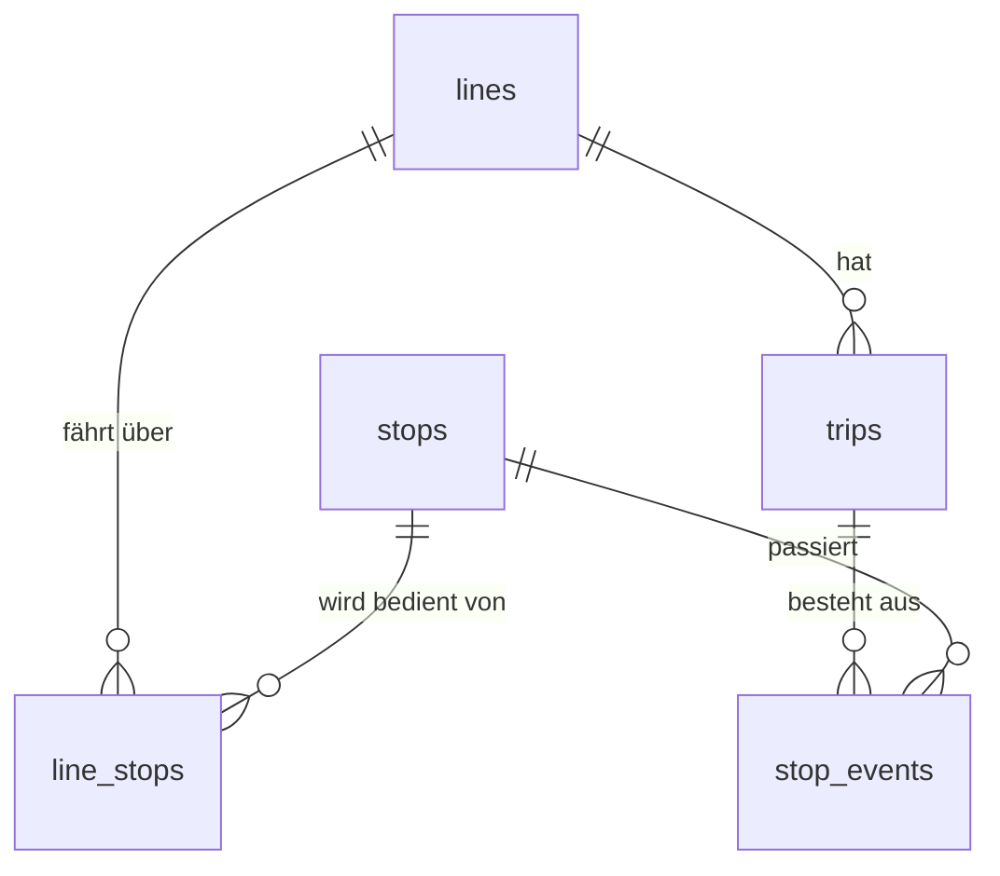

# Lecture 1: Relating

Orientierung: [CS50 SQL, Lecture 1 „Relating“](https://cs50.harvard.edu/sql/): mehrere Tabellen, Schlüssel, Subqueries, `JOIN`.

**Ziel:** Studierende verstehen, warum Daten auf Tabellen verteilt werden, und können sie wieder zusammenführen.
**Datenbank:** `kvv` (Tabellen `lines`, `stops`, `line_stops`, `trips`, `stop_events`). Aufgaben 1.1 bis 1.6.

## Das Modell



- `lines` und `stops` sind Stammdaten, `line_stops` verbindet sie (n:m, mit `position`).
- `trips` sind einzelne Fahrten, `stop_events` die Halte einer Fahrt (das ist der Inhalt der flachen Tabelle `delays` aus Lecture 0, nur ohne Wiederholungen).

## Ablauf (ca. 45 Minuten)

| Min | Was | Wie |
|---|---|---|
| 0–10 | Problem der flachen Tabelle: Haltestellennamen stehen tausendfach da, Tippfehler, Änderungen an 1000 Stellen | `SELECT COUNT(DISTINCT stop) FROM delays` vs. Zeilenzahl |
| 10–15 | Primärschlüssel, Fremdschlüssel, `.schema` in `kvv` ansehen | `uv run sqlkurs shell kvv` |
| 15–25 | Subquery: erst die ID holen, dann damit filtern | Aufgaben 1.1, 1.2 |
| 25–40 | `JOIN`, mehrere Joins hintereinander, `GROUP BY` über Joins | Aufgaben 1.3 bis 1.5 |
| 40–45 | `LEFT JOIN` und `NULL`: Was fehlt? | Aufgabe 1.6 |

## Live-Demo (zum Mittippen)

```sql
-- Subquery
SELECT name FROM stops
WHERE id IN (SELECT stop_id FROM line_stops
             WHERE line_id = (SELECT id FROM lines WHERE name = 'S1'));

-- dasselbe mit JOIN
SELECT stops.name
FROM lines
JOIN line_stops ON line_stops.line_id = lines.id
JOIN stops ON stops.id = line_stops.stop_id
WHERE lines.name = 'S1'
ORDER BY line_stops.position;
```

## Stolpersteine

- Bei Joins Spaltennamen mit Tabelle qualifizieren (`stops.name`), `name` gibt es in `lines` und `stops`.
- `JOIN` ohne `ON` erzeugt alle Kombinationen.
- `INNER JOIN` verliert Zeilen ohne Partner, `LEFT JOIN` behält sie (mit `NULL`).
- Warum `line_stops` und nicht eine Spalte `stops` in `lines`? Eine Zelle, ein Wert.
